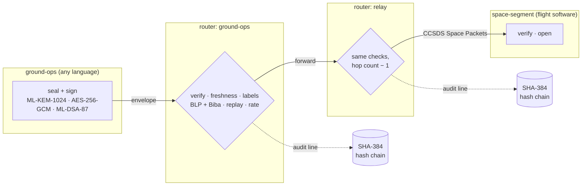

# interlingua

[](https://github.com/RobS96/interlingua/actions/workflows/ci.yml)
[](https://scorecard.dev/viewer/?uri=github.com/RobS96/interlingua)
[](https://www.bestpractices.dev/projects/16678)
[](#license)
[](https://www.rust-lang.org)

**A security-first, polyglot message fabric.** One canonical message format
that Rust, C, Swift, Go and Java read and write byte for byte alike; signed
with ML-DSA-87 and sealed with ML-KEM-1024 + AES-256-GCM (the CNSA 2.0
suite); routed between labelled trust domains by a deny-by-default policy
with a hash-chained audit trail; and framed as CCSDS Space Packets for
flight and ground segments.

> **Independent project.** interlingua is not affiliated with, endorsed by,
> or connected to NASA, IEEE, Nokia Bell Labs, CISA, the CIA, NSA, NIST,
> CCSDS or any other organisation whose public standards it follows. It routes
> between trust domains *you* define. It is not accredited for classified
> information. See [DISCLAIMER.md](DISCLAIMER.md).

## Why

Systems that span languages and platforms usually translate pairwise: each
pair of components agrees on its own conversion, and N components need
N×(N−1)/2 translators that drift apart. interlingua takes the *interlingua*
route from machine translation instead: **every language maps to one
canonical form**, so N languages need N codecs, and all of them are checked
against the **same published test vectors** rather than against each other.

That canonical form is strict: deterministic CBOR (RFC 8949 §4.2.1) whose
decoder rejects every alternative encoding (non-shortest integers, wider
floats, unsorted keys, indefinite lengths …). Because each value has exactly
one encoding, a signature means the same thing in every language: no parser
differentials, no "it verified in Java but not in Go".

## What it does



* **Envelopes** ([SPECIFICATION §6](docs/SPECIFICATION.md#6-envelope)): a signed header (source, destination,
  label, times, hop limit, signer) and a payload that is plaintext or sealed
  end to end to the destination: relays route it without being able to read it.
* **Labels** ([§5](docs/SPECIFICATION.md#5-security-labels)): every message carries a FIPS 199
  confidentiality / integrity / availability category plus compartments.
* **Routing** ([§8](docs/SPECIFICATION.md#8-router-processing), [POLICY.md](docs/POLICY.md)): 24 ordered checks, including
  Bell–LaPadula (no write-down to an uncleared domain), Biba (no low-integrity
  data into a high-integrity domain), mandatory sealing, replay and rate limits,
  and a deterministic shortest permitted path.
* **Audit** ([§8.3](docs/SPECIFICATION.md#83-audit-records)): one tamper-evident line per decision, accepted or not.
* **Space links** ([§10](docs/SPECIFICATION.md#10-ccsds-space-packet-framing)): CCSDS 133.0-B-2 Space Packets with segmentation
  and gap detection, so envelopes ride existing telemetry/telecommand paths.

## Proven interoperability

Every number below was produced by the commands in this repository, on
macOS 26 (x86_64) during the build; CI re-runs them on Linux and macOS.

| Implementation | What runs | Result |
|---|---|---|
| Rust reference | unit, conformance, robustness (100 000 mutated inputs), FFI, doc tests | 41 / 41 |
| Rust reference | `il vectors check spec/vectors` | 234 / 234 |
| C binding (C11) | all five vector suites, AddressSanitizer + UBSan | 226 / 226 |
| Go binding (cgo) | five vector suites + Go standard-library cross-checks | 10 / 10 tests |
| Swift binding | five vector suites | 226 / 226 |
| Apple CryptoKit (independent) | ML-DSA-87 keygen from the published seeds, signature verification, HKDF + AES-GCM, an envelope built entirely in CryptoKit that the Rust reference opens and routes | 20 / 20 |
| Go `crypto/mldsa`, `crypto/mlkem`, `crypto/hkdf` (independent) | the same, built with Go's standard library only | 4 / 4 tests |
| OpenSSL 3.5.9 and 4.1.0 (independent) | ML-DSA-87 verification, ML-KEM-1024 decapsulation, HKDF-SHA-384 | 6 / 6 each |
| Java binding (JDK 25 FFM) + JDK ML-DSA / ML-KEM / HKDF | five vector suites + JDK cross-checks | CI only |

Four cryptographic implementations that share no code (AWS-LC in the
reference, Apple CryptoKit, Go's standard library, OpenSSL; the JDK in CI)
agree on keys, signatures, key establishment and key derivation, and two of
them build complete envelopes the reference accepts. That is the strongest form of "harmonious" this project can offer:
not a claim, a test you can run.

## Quick start

```bash
cargo build --release                    # needs Rust 1.88+ and a C compiler (AWS-LC)
il=target/release/il

$il keygen ground-ops ground             # ground.key (0600) + ground.pub
$il keygen space-segment craft
cat ground.pub craft.pub > keyring.pub

printf 'SAFE MODE EXIT' | $il seal --key ground.key --dst space-segment --to craft.pub \
    --label 'conf=moderate integ=high avail=high comp=tt-c' > cmd.il
$il inspect < cmd.il                     # header, unverified
$il open --keyring keyring.pub --key craft.key < cmd.il
```

The full story (keys, a relayed telecommand, a refused policy violation,
caught tampering, audit-chain verification, CCSDS framing) is one script:

```bash
examples/constellation/run.sh target/release/il
```

Language bindings: [C](bindings/c/README.md) · [Swift](bindings/swift/README.md)
(macOS, iOS) · [Go](bindings/go/README.md) · [Java](bindings/java/README.md)
(JDK 22+ Foreign Function & Memory API). Rust users depend on the
`interlingua` crate directly.

## Standards alignment

interlingua is built to the public standards below and documents, control by
control, what it provides and what remains the operator's job. *Aligned with*
is not *certified by*: see [docs/compliance/](docs/compliance/README.md).

| Area | Standards | Where |
|---|---|---|
| Cryptography | NSA CNSA 2.0; FIPS 203, 204, 197, 180-4; SP 800-38D, 800-56C | [CNSA-2.0](docs/compliance/CNSA-2.0.md), [FIPS-140-3](docs/compliance/FIPS-140-3.md) |
| Security controls | NIST SP 800-53 Rev. 5 (AC-4, SC-8, SC-13, SC-16, AU-9, SI-10 …) | [NIST-SP-800-53r5](docs/compliance/NIST-SP-800-53r5.md) |
| Categorization | FIPS 199, CNSSI No. 1253 (the C-I-A triad) | [FIPS-199-CNSSI-1253](docs/compliance/FIPS-199-CNSSI-1253.md) |
| Secure development | NIST SP 800-218 (SSDF); CISA Secure by Design; CISA/NSA memory-safety guidance | [NIST-SSDF](docs/compliance/NIST-SSDF.md), [CISA](docs/compliance/CISA-SECURE-BY-DESIGN.md), [roadmap](docs/MEMORY-SAFETY-ROADMAP.md) |
| Space systems | CCSDS 133.0-B-2; NASA NPR 7150.2D, NASA-STD-8739.8 | [CCSDS](docs/compliance/CCSDS.md), [NASA](docs/compliance/NASA-NPR-7150.2.md) |
| Engineering | IEEE 754-2019, IEEE Std 1003.1 (POSIX), ISO/IEC/IEEE 42010, 12207, 29119 | [IEEE](docs/compliance/IEEE.md) |
| Supply chain | SLSA provenance, CycloneDX SBOM, OpenSSF Scorecard, cargo-vet, cargo-deny | [SUPPLY-CHAIN](docs/compliance/SUPPLY-CHAIN.md) |

## Security model in brief

* `#![forbid(unsafe_code)]` in the library and CLI; `unsafe` exists only at
  the C ABI boundary, where every pointer is checked and panics are caught.
* One cryptographic module (AWS-LC; FIPS 140-3 module with `--features fips`);
  no algorithm negotiation, nothing to downgrade.
* Every decoder is strict, bounded and fuzzed; the router changes state only
  after every check passes, and fails closed.
* No clock, network or file I/O in the library: time and bytes are inputs,
  so every decision is reproducible.
* [THREAT-MODEL.md](docs/THREAT-MODEL.md) lists what is defended, and what is
  not (visible metadata, no forward secrecy for sealed payloads, audit
  truncation without an external anchor).

## Repository layout

```
crates/interlingua/      the library: cbor, label, envelope, crypto, keys, policy, router, audit, ccsds, vectors
crates/interlingua-ffi/  the C ABI (the only crate with unsafe code)
crates/interlingua-cli/  the `il` command and the vector generator
bindings/                c/ (header + conformance), swift/, go/, java/
spec/                    interlingua.cddl and the conformance vectors
docs/                    specification, architecture, threat model, interop, policy, operations, compliance, ADRs
examples/constellation/  an end-to-end walk-through
fuzz/                    cargo-fuzz targets (CI)
```

## Building and testing

```bash
make            # rust (fmt, clippy -D warnings, tests) + C + Go + Swift + vectors
make java       # needs JDK 25
make openssl    # needs OpenSSL 3.5+
make supply     # cargo deny + cargo vet
```

Contributions: [CONTRIBUTING.md](CONTRIBUTING.md). Security reports:
[SECURITY.md](SECURITY.md) (privately, never in an issue). Governance:
[GOVERNANCE.md](GOVERNANCE.md).

## Status

Version 0.1.0, pre-release. The wire format may still change before 1.0
(changes bump `version`; see [SPECIFICATION §13](docs/SPECIFICATION.md#13-extension-and-versioning)). It has not had an external
security audit. [ROADMAP.md](docs/ROADMAP.md) lists what comes next (DTN
Bundle Protocol adapter, hybrid KEM suite, XCFramework, Maven Central).

## License

Dual-licensed under [MIT](LICENSE-MIT) or [Apache-2.0](LICENSE-APACHE), at
your option. The same two texts are also in [LICENSES/](LICENSES/), the
[REUSE](https://reuse.software/spec/) layout that license scanners look for.
Third-party notices: [NOTICE](NOTICE).
