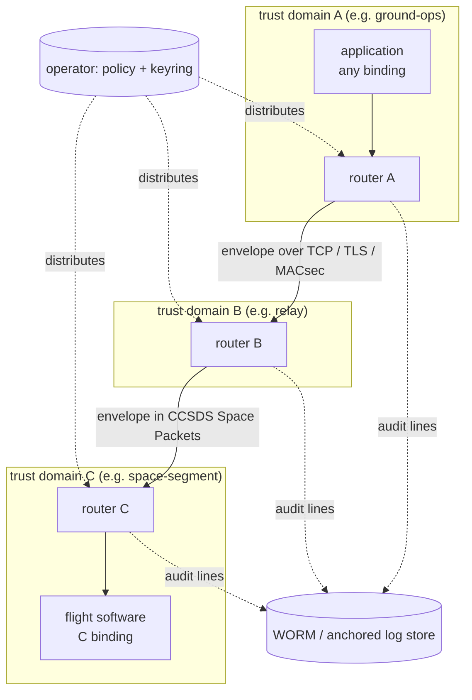
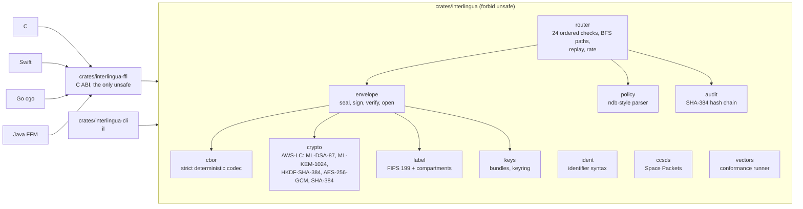

# Architecture

This description follows the structure of ISO/IEC/IEEE 42010:2022: who has a
stake, what concerns them, and one view per concern. Normative behaviour is in
[SPECIFICATION.md](SPECIFICATION.md); decisions and their rationale are in
[adr/](adr/).

## 1. Stakeholders and concerns

| Stakeholder | Concerns |
|---|---|
| Mission / system operators | Messages arrive only where policy allows; decisions are auditable; it runs on ground and flight hardware |
| Application developers (Rust, C, Swift, Go, Java) | One API shape per language; identical behaviour everywhere; clear errors |
| Security assessors | Which controls are implemented, where, with what evidence; residual risk |
| Flight-software engineers | Bounded memory and CPU, no dynamic surprises, CCSDS-compatible framing, C integration |
| Maintainers | Small trusted base, testable without network or clocks, reproducible decisions |

## 2. Context view

interlingua is a **library plus a C ABI**. It does not open sockets, read
clocks or touch files: a host program (the `il` CLI, a daemon, flight
software) owns transport, time, persistence and key storage, and calls the
library for every security decision. This keeps the trusted code small and
makes every decision reproducible from its inputs.

## 3. Logical view (components)

| Module | Responsibility | Depends on |
|---|---|---|
| `cbor` | the canonical form; rejects every non-canonical input | — |
| `ident`, `label` | syntax and FIPS 199 rules | `cbor` |
| `crypto` | every primitive, through one module (AWS-LC); zeroization | AWS-LC |
| `keys` | text bundles, keyring binding each key to one domain | `crypto` |
| `envelope` | build, seal, sign, decode, verify, open | `cbor`, `crypto`, `keys`, `label` |
| `policy` | parse and validate the routing policy | `label`, `ident` |
| `router` | the decision procedure; state: replay cache, rate buckets, audit head | `envelope`, `policy`, `audit` |
| `audit` | hash-chained records and their verification | `crypto` |
| `ccsds` | CCSDS 133.0-B-2 framing | — |
| `vectors` | parse `.rsp`, check every feature | all |

## 4. Interoperability view

The C ABI is the single seam between languages ([INTEROP.md](INTEROP.md)):
byte ranges and UTF-8 strings in, library-owned buffers out, stable error
identifiers, one opaque thread-safe handle (the router). Each binding is a
thin, idiomatic wrapper; none re-implements the format, so none can drift.
Agreement is then *checked*, not assumed: every binding runs the shared
vectors, and independent implementations (Apple CryptoKit, Go's standard
library, the JDK, OpenSSL) check the cryptography, two of them by building
whole envelopes from scratch.

## 5. Security view

Trust boundaries, assets and threats are in [THREAT-MODEL.md](THREAT-MODEL.md).
The architecture's security properties:

* **Authenticity is end to end.** The source signs; every router and the
  destination verify against a keyring that binds keys to domains.
* **Confidentiality is end to end.** Sealing targets the destination's key;
  relays route sealed payloads they cannot read.
* **Policy is enforced at every hop**, not only at the edge: each router
  re-checks the label against its own policy view, and accepts from a
  neighbour only over an edge the policy defines.
* **Fail closed.** Any failed check rejects; state changes only on
  acceptance; full caches refuse rather than forget.
* **Small trusted base.** `unsafe` is confined to the C ABI crate; one
  cryptographic module; 15 third-party crates for this platform, gated by
  cargo-deny and cargo-vet.

## 6. Deployment view

| Deployment | How |
|---|---|
| Ground service | a daemon embedding the Rust crate (or the C ABI), one router per domain, TLS 1.3 or MACsec between hosts, audit lines shipped to append-only storage |
| Flight software | the static C library linked into a flight application (for example a NASA core Flight System app), envelopes in CCSDS Space Packets over the existing TM/TC path, SDLS on the link |
| Apple platforms | the Swift package (XCFramework for iOS apps, see the roadmap); keys in the Keychain or Secure Enclave-wrapped storage |
| JVM services | the Java binding over the shared library (`--enable-native-access`) |
| Command line / scripting | `il`, composing with other tools through stdin and stdout |

## 7. Quality attributes and how they are met

| Attribute | Mechanism | Evidence |
|---|---|---|
| Correctness across languages | one implementation behind a C ABI; shared vectors | binding test results ([README](../README.md#proven-interoperability)) |
| Robustness | strict, bounded decoders; fuzzing; property tests | `fuzz/`, `tests/robustness.rs` |
| Determinism | no clock or I/O in the library; sorted neighbour order; integer token buckets | routing vectors identical in every binding |
| Performance | one ML-DSA-87 verification and at most one ML-KEM-1024 decapsulation per hop; no allocation per byte; release builds use LTO | — |
| Portability | Rust + C ABI; Linux and macOS in CI; iOS via Swift; `no I/O` core suits embedded hosts | CI matrix |
| Maintainability | small modules, stable error identifiers, ADRs, spec-first changes | [CONTRIBUTING.md](../CONTRIBUTING.md) |
